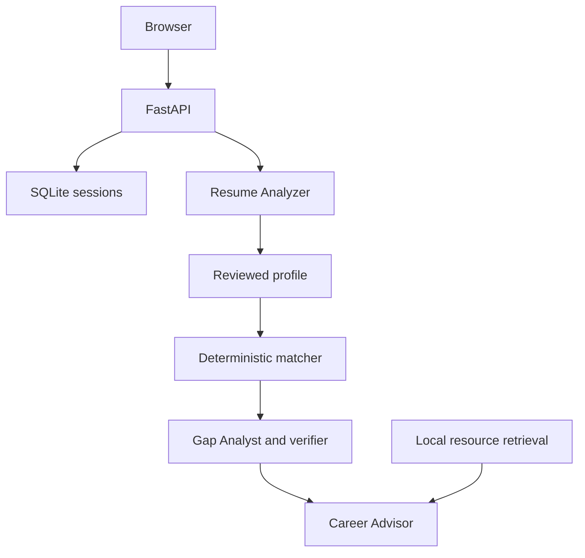

# Resume2Job

A local-first resume-to-job matching application: upload or paste a resume, correct its profile, find relevant roles, inspect explainable scores and gaps, and receive evidence-based actions.

**No paid AI APIs, API keys or runtime job APIs are required.** The included interface and dataset work without internet after Python dependencies are installed. Generative AI is optional and requires your own local Ollama installation and downloaded model. Electricity, hardware and initial downloads are not cost-free infrastructure.

## Quick start — Windows

1. Install **Python 3.12** from https://www.python.org/downloads/ (include the Python launcher).
2. Extract this entire folder from the ZIP.
3. Double-click **start.bat**. Keep the terminal open.
4. Open **http://127.0.0.1:8000**.
5. Choose **Ayesha · Student**, review the profile, then **Find my matches**.

The launcher installs dependencies on first use. Subsequent runs may check the package index; for fully offline startup after installation run:

```bat
.venv\Scripts\python.exe -m uvicorn app.main:app --host 127.0.0.1 --port 8000
```

## macOS / Linux

With Python 3.12 installed:

```bash
chmod +x start.sh
./start.sh
```

Or manually on any platform:

```bash
python -m venv .venv
# Windows: .venv\Scripts\activate
# macOS/Linux: source .venv/bin/activate
python -m pip install -r requirements.txt
python -m uvicorn app.main:app --host 127.0.0.1 --port 8000
```

Keep the full directory structure. Do not double-click `static/index.html`; the page needs the Python backend.

## What is included

- Validated PDF upload (5 MB / 5 pages) with pdfplumber and PyMuPDF fallback; paste text alternative.
- Editable skills, education, work, projects, certifications, achievements and experience estimate.
- **180 local jobs**: 172 cached public records from Arbeitnow UK plus eight labeled synthetic demo roles. Snapshot date is in each public record. Jobs are not guaranteed open and remote work may have country restrictions.
- **366 skill entries** and aliases shared by parsing and matching.
- Six configurable scoring components: 35/10/20/15/10/10. The displayed components sum to the score.
- Skill, qualification, experience and literal keyword evidence; related/implied skills remain unconfirmed.
- Grounded recommendations and retrieval from 14 local learning-resource chunks, with source links.
- Optional local LLM extraction, gap nuance and a Career Advisor with at most four tool calls.
- Strict formatting-only resume improvements, text report export, profile restoration, deletion and 24-hour retention.

## Local generative AI with Ollama

1. Install Ollama from https://ollama.com/download and start it.
2. Check your computer's available RAM and disk space. Choose a small instruction-tuned model from the Ollama library that fits your hardware; larger models can be slow on CPU. No model is chosen or downloaded automatically.
3. Download that model: `ollama pull YOUR_MODEL_TAG`. Then check `ollama list`.
4. Copy `.env.example` to `.env` and set:

```dotenv
LLM_BASE_URL=http://127.0.0.1:11434/v1
LLM_MODEL=YOUR_EXACT_INSTALLED_MODEL_TAG
```

5. Restart the app. Create a fresh sample profile and inspect **Workflow activity** after analysis. Actual tool calls appear only when the model makes them successfully.
6. Run `python scripts/doctor.py` to inspect model availability and configuration.

The client uses Ollama's documented OpenAI-compatible local endpoint: https://docs.ollama.com/api/openai-compatibility. This does **not** use OpenAI's hosted service. Only loopback and Docker host addresses are allowed; no cloud fallback or API key exists.

Per-call timeout is 12 seconds, extraction budget 15 seconds, analysis budget 38 seconds. An unavailable/slow model triggers a short circuit breaker and the deterministic fallback. Small models may fail the JSON/tool protocol; the UI reports fallback honestly. These timeouts favor a responsive demo over waiting indefinitely for CPU inference. Adjust deliberately in `app/llm.py` after benchmarking your hardware.

## Optional local embeddings

Default similarity is TF-IDF cosine over the fixed job corpus. For semantic embeddings:

```bash
python -m pip install -r requirements-ai.txt
```

Download a small sentence-transformers model separately, then set `EMBEDDING_MODEL_PATH` to its local model directory and restart. The app uses `local_files_only=True` and never downloads a model during requests. Job vectors are cached in memory; failures use TF-IDF. The result labels the method actually used.

## Architecture and truthfulness



`app/engine.py` owns dates, aliases, filters and score arithmetic. `app/analysis.py` owns gap facts, keyword coverage and verified action templates. `app/agents.py` owns the three optional LLM roles; the Career Advisor chooses evidence tools and selects approved action IDs. `app/retrieval.py` indexes local job documents and learning chunks. Retrieval really happens; it is not a simulated activity log. Generated advice is intentionally constrained to verified actions instead of publishing unchecked model prose.

The original PRD min-max normalization is replaced by raw cosine over a stable corpus, so changing filters does not arbitrarily rescale similarity. Profile edits affect ranking; removed skill text is not secretly reintroduced. Scores are fit estimates, not hiring probabilities.

Extracted text lists remain simple editable lines to preserve the supplied project's UI/API structure. Work dates are merged deterministically. Qualification requirements and candidate evidence are shown together; degree equivalence needs human review. Strict resume editing only accepts formatting cleanup. Fluent factual paraphrases are deliberately not delivered as verified truth.

## Job data and updates

The bundled public records were obtained from the public Arbeitnow UK API. Attribution and original posting links appear in the UI and each record. Read https://www.arbeitnow.com/terms (API section) and https://www.arbeitnow.com/blog/job-board-api before refreshing or redistributing data. Requirements are automatically extracted mentions, not human-certified job requirements. Check the posting.

Optional one-time refresh (internet needed):

```bash
python scripts/snapshot_jobs.py
```

Restart afterwards. No refresh is performed automatically. A failed refresh leaves the last file intact. CSV import is also supported:

```bash
python scripts/import_jobs.py data/sample_import.csv --source "Your dataset name and license" --out data/import-preview.json
```

Review the preview first; choose `--out data/jobs.json` only when ready to replace the active dataset. Use `--append` to extend it. Seeding needs no database service: the app loads `data/jobs.json` and creates its SQLite session store automatically.

## API

Interactive schema: `/docs` (the OpenAPI JSON is `/openapi.json`). The Swagger UI uses its own external CDN assets; the actual application does not.

- `POST /api/resumes` — PDF upload and extraction
- `POST /api/resumes/text` — paste-text fallback
- `POST /api/resumes/{id}/profile/extract` — cached extraction, preserving edits
- `GET/PUT /api/resumes/{id}/profile`
- `PUT /api/resumes/{id}/preferences`
- `POST /api/resumes/{id}/matches`
- `GET /api/jobs/{id}`
- `POST /api/analyses` — `{ "resume_id": "...", "job_id": 1 }`
- `GET /api/analyses/{id}`
- `POST /api/analyses/{id}/improve`
- `DELETE /api/resumes/{id}`
- `GET /api/health`

Legacy resume/job analysis routes remain supported. Save the session cookie when calling APIs outside the browser. Every resume and analysis operation checks both the anonymous cookie and the resume ID. Errors share `{ "error": { "code": "...", "message": "..." } }`.

## Privacy and local operation

Bind to `127.0.0.1` for personal use. The original PDF is never saved. Extracted text, edits and analyses are stored in `runtime/resume2job.db` on this server; no resume content is logged by application code. Local model inference receives resume text if enabled. Delete removes the row and its embedded analyses using SQLite secure deletion. Startup and storage access purge records older than 24 hours; a stopped process cannot run cleanup. Browser storage holds only the resume ID, and the owner cookie is HttpOnly/SameSite Strict. No accounts or public resume listings exist.

The database is not encrypted. This is a local hackathon app, not a hardened hosted service. Before public deployment add HTTPS, proper operational retention, upload rate/concurrency controls at the proxy, and a reviewed authentication model. Keep `.env` and `runtime/` out of source control.

## Tests and demo

```bash
python -m pip install -r requirements-dev.txt
python -m pytest -q
```

Five synthetic candidate fixtures are in `tests/fixtures/`. Generated sample PDFs are in `demo/`. Regression tests cover deterministic ranking, PDF failure paths, date merging, agent schema failures, unsupported claims, API ownership, invalidation, expiry and data integrity.

Five-minute demo:
1. Upload `demo/ayesha.pdf` or choose Ayesha.
2. Review her internship estimate and editable fields.
3. Search junior Python/backend roles. Note the public/synthetic source disclosure.
4. Select Junior Backend Developer (Python), then inspect score components and Docker/CI/CD gaps.
5. Open Actions to see evidence and retrieved resources; export a report.
6. Repeat with Omar to show stronger technical coverage. Delete data afterwards.

Real-model quality and latency must be checked on your own hardware; mocked model tests verify protocol and rejection behavior, not the intelligence of any particular model.

## Docker

```bash
docker build -t resume2job .
docker run --rm -p 127.0.0.1:8000:8000 resume2job
```

The default container is disposable. To retain sessions, mount a writable volume at `/app/runtime` owned by the container user. For host Ollama, explicitly set `LLM_BASE_URL=http://host.docker.internal:11434/v1` and `LLM_MODEL`; on Linux add the appropriate host-gateway mapping. Docker operation is supplied but not verified in this workspace.

## Troubleshooting

- **Page cannot connect:** keep the terminal running and open port 8000, not the HTML file.
- **Port occupied:** stop the old server or add `--port 8001` and use that URL.
- **No results:** relax mode, location or level; enable stretch roles. Dataset geography is limited.
- **PDF rejected/scanned:** use paste text and correct the profile manually.
- **Model configured but no AI output:** check `ollama list`, exact model tag and `scripts/doctor.py`; pre-warm the model and retry after 30 seconds.
- **Old analysis after edits:** edits automatically invalidate cached analyses; return to matches and analyze again.
- **Expired session:** upload/paste again. Anonymous sessions last up to 24 hours.
- **Dependency install fails:** use Python 3.12 and check internet/proxy access. The packaged runtime dependencies are pinned to the tested environment.

See `docs/AUDIT.md` for the original findings and deliberate scope decisions, and `docs/VERIFICATION.md` for actual checks and limits.
